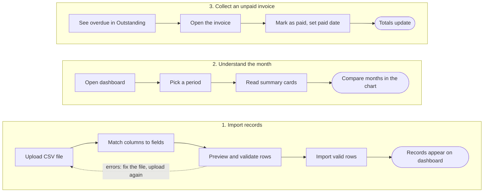
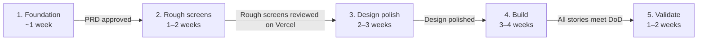

Source of truth. Change this file through pull requests; it is not exported from anywhere.

# Studio Ledger — Product Requirements Document

Oct 19, 2026

> **At a glance.** Studio Ledger helps freelance creatives see what they've received, what they've spent, and who still owes them. The MVP is four things: an overview dashboard, invoices and clients, expenses, and CSV import.

## Overview

Studio Ledger is a personal finance dashboard that shows freelance creatives what they have received, what they have spent, and which clients still owe them money. This PRD defines the MVP: an overview dashboard, invoice and client management, expense tracking, and CSV import.

| Release | Platform | Context |
| --- | --- | --- |
| MVP (v1.0) | Responsive web app (Vite, React, TypeScript, Tailwind, shadcn/ui) | Design engineer portfolio project: strategy, UX, design system, build, case study |

> **Source of truth.** This PRD is the reference for the screens, Codex tasks, GitHub issues and the case study. A feature not described here is out of scope until this document is updated.

---

## Problem statement

Freelancers spread invoices, clients, income and expenses across several spreadsheets and tools, so answering "how am I doing?" takes manual calculation.

The consequences are concrete:

- Unpaid and overdue invoices go unnoticed, so follow-ups happen late or not at all.
- Billed revenue gets confused with cash actually received, which overstates income.
- Spending is hard to see by month or category, so budgeting is guesswork.

**Opportunity:** one place that turns financial records into a few clear numbers and lists, built around the freelancer's real questions rather than accounting features.

> **Primary user goal**
>
> *"I want to understand how much money I've received, how much I've spent, and which clients still owe me money."*

---

## Target users

The primary audience is independent designers and other creative freelancers who manage several clients at once and track money themselves.

**Proto-persona: Maja, freelance brand designer** (assumption, checked during usability testing)

| Attribute | Detail |
| --- | --- |
| Work | 4–8 active clients, project and retainer work |
| Volume | 5–15 invoices and 20–40 expenses per month |
| Current tools | A spreadsheet for invoices, a banking app, notes for expenses |
| Main frustration | Not knowing at a glance who has paid and who is late |
| Comfort with finance | Low to medium; avoids accounting software as too complex |

**Jobs to be done**

1. When a month ends, I want to see what I earned and spent, so I know whether I'm on track.
2. When a client is late, I want to spot it quickly, so I can follow up before it becomes a problem.
3. When I get paid, I want to update the invoice in seconds, so my numbers stay accurate.
4. When I start using a new tool, I want to bring in my existing records, so I don't retype everything.

**Secondary audience (not designed for in MVP):** freelance developers, writers and consultants with similar workflows.

---

## Alternatives and positioning

Studio Ledger competes with spreadsheets more than with accounting software: it answers three questions and nothing else.

| Alternative | What it does well | Where it falls short for our user |
| --- | --- | --- |
| Spreadsheets | Free, flexible, already in use | Manual formulas; no overdue alerts; easy to break |
| Invoicing and accounting apps (e.g. FreshBooks, Wave) | Create and send invoices, full bookkeeping | More features and setup than a solo creative needs |
| Freelancer suites (e.g. Bonsai) | Contracts, proposals, invoicing in one place | Broad scope; finances are one module among many |
| Banking apps | Accurate record of cash in and out | No link between payments, invoices and clients |

**Positioning:** the simplest way for a freelance creative to see what they've received, spent and are owed, using the records they already keep. Competitor details are to be checked during discovery.

---

## Goals and success metrics

The MVP succeeds if a freelancer can answer the three core questions in under 10 seconds from the dashboard, using data they imported themselves.

**Product goals**

1. Show received income, expenses and outstanding payments accurately and at a glance.
2. Make it fast to find and update unpaid or overdue invoices.
3. Let users bring in existing records through CSV import.

**Portfolio goals**

1. Demonstrate an end-to-end process: strategy, UX, design system, build, validation.
2. Ship a deployed, working app, not only mockups.
3. Be explicit about what was validated and what was assumed.

**Success metrics (measured in usability testing, 2–3 participants)**

| Metric | Target |
| --- | --- |
| Find total received this month | ≥ 90% success, under 10 s |
| Identify which clients owe money | ≥ 90% success, under 15 s |
| Mark an invoice as paid | ≥ 90% success, under 20 s |
| Complete a CSV import with a sample file | ≥ 80% success without help |
| Post-test ease rating (SEQ, 1–7) | Average ≥ 5.5 per task |
| Calculation accuracy against test dataset | 100% (automated tests) |

> **Non-goals.** Replacing accounting software, filing taxes, processing payments, or serving teams and agencies.

---

## Core user journeys

Three journeys define the MVP; each must be completable without help and is covered by an end-to-end test.



Import is the only journey with a branch: rows with errors send the user back to fix the file, or they import only the valid rows.

---

## Features and user stories

The MVP has four feature areas plus sample data for the prototype. Priorities use MoSCoW: Must = required for release, Should = include if time allows.

| ID | Story | Priority |
| --- | --- | --- |
| US-1.1 | See key figures for a chosen period | Must |
| US-1.2 | Compare income and expenses by month | Must |
| US-1.3 | See which clients owe me money | Must |
| US-1.4 | See recent activity | Should |
| US-2.1 | Add an invoice linked to a client | Must |
| US-2.2 | Mark an invoice as paid, or back to unpaid | Must |
| US-2.3 | Filter and search invoices | Must |
| US-2.4 | Edit or delete an invoice | Must |
| US-2.5 | See clients with paid and owed totals | Should |
| US-3.1 | Record an expense | Must |
| US-3.2 | View, filter, edit and delete expenses | Must |
| US-4.1 | Upload a CSV of invoices or expenses | Must |
| US-4.2 | Match columns, date format and decimals | Must |
| US-4.3 | Preview and validate before importing | Must |
| US-4.4 | See imported records on the dashboard | Must |
| US-5.1 | Load sample data and clear all data | Must |
| US-5.2 | Choose the app currency | Must |

Full user stories and acceptance criteria are in [Stories and acceptance criteria](#stories-and-acceptance-criteria) below.

---

## Data model

The MVP stores three entities: Client, Invoice and Expense. Invoice status is partly stored (Paid / Unpaid) and partly derived (Overdue), so it can never drift out of date.

**Client**

| Field | Type | Required | Notes |
| --- | --- | --- | --- |
| id | string (UUID) | Yes | Generated |
| name | string | Yes | Unique, case-insensitive |
| email | string | No | Valid email format |
| createdAt | datetime | Yes | Generated |

**Invoice**

| Field | Type | Required | Notes |
| --- | --- | --- | --- |
| id | string (UUID) | Yes | Generated |
| invoiceNumber | string | Yes | Unique, e.g. INV-024 |
| clientId | string | Yes | References Client |
| amount | integer (cents) | Yes | > 0; stored in cents to avoid rounding errors |
| issueDate | date | Yes |  |
| dueDate | date | Yes | ≥ issueDate |
| paidDate | date | No | Set when marked paid; required if status is Paid |
| status | enum | Yes | Stored: Paid, Unpaid. Displayed: Paid, Pending, Overdue |
| description | string | No | Max 200 characters |
| source | enum | Yes | Manual, Import, Sample |

**Expense**

| Field | Type | Required | Notes |
| --- | --- | --- | --- |
| id | string (UUID) | Yes | Generated |
| date | date | Yes |  |
| amount | integer (cents) | Yes | > 0 |
| category | enum | Yes | Software, Equipment, Office, Travel, Marketing, Education, Fees, Other |
| description | string | No | Max 200 characters |
| source | enum | Yes | Manual, Import, Sample |

**CSV columns (sample files)**

```csv
invoice_number,client,amount,issue_date,due_date,paid_date,description
INV-001,Northwind Studio,1200.00,2026-04-02,2026-04-16,2026-04-14,Brand refresh phase 1
INV-002,Lumen Coffee,850.00,2026-04-10,2026-04-24,,Menu design
```

```csv
date,amount,category,description
2026-04-01,54.99,Software,Figma subscription
2026-04-08,320.00,Equipment,Drawing tablet
```

**Import formats.** The importer accepts dates as YYYY-MM-DD, DD.MM.YYYY, DD/MM/YYYY or MM/DD/YYYY, and amounts with a dot or comma decimal separator; the user confirms both while matching columns.

**Currency.** One currency per account, chosen in Settings: USD (default), EUR or BAM. Switching changes how every amount is labelled and formatted; amounts are not converted, so invoices and expenses carry no currency field.

---

## Financial definitions and calculation rules

> **The golden rule.** Income counts only when cash is received: a paid invoice counts in the period of its paid date, never its issue date. Billed revenue is never shown as income.

**Glossary.** These terms are used everywhere: in this PRD, in the UI and in code. No synonyms in the UI.

| Term | Meaning |
| --- | --- |
| Received | Money from invoices marked Paid |
| Outstanding | Money from all invoices not yet paid |
| Pending | An unpaid invoice whose due date has not passed |
| Overdue | An unpaid invoice whose due date has passed |
| Unpaid | Stored status covering Pending and Overdue; never shown in the UI |
| Expenses | Money spent, recorded as expense entries |
| Net income | Received minus Expenses for the period |

| Metric | Definition | Period rule |
| --- | --- | --- |
| Received income | Sum of amounts of Paid invoices | paidDate within the selected period |
| Outstanding | Sum of amounts of all Unpaid invoices | Current snapshot, ignores period |
| Overdue | Sum of Unpaid invoices where dueDate < today | Current snapshot, ignores period |
| Expenses | Sum of expense amounts | date within the selected period |
| Net income | Received income − Expenses | Selected period |
| Change vs previous | (Current − Previous) ÷ Previous × 100 | Previous period of equal length; Received, Expenses and Net income only |

**Periods**

Periods are whole calendar months, and "Last 3 months" and "Last 6 months" include the current month. The dashboard opens on Last 6 months. The Expenses list also offers All time and opens on it.

| Period | Months covered | Example on 2026-10-20 |
| --- | --- | --- |
| This month | The current calendar month | October 2026 |
| Last month | The previous calendar month | September 2026 |
| Last 3 months | The current month and the 2 before it | August–October 2026 |
| Last 6 months | The current month and the 5 before it | May–October 2026 |
| This year | January to December of the current year | January–December 2026 |

The previous period for a change is the same number of whole months right before it: Last 6 months on 2026-10-20 is compared with November 2025–April 2026.

**Displayed invoice status**

- **Paid:** status is Paid (paidDate is set).
- **Overdue:** status is Unpaid and dueDate is before today.
- **Pending:** status is Unpaid and dueDate is today or later.

**Edge cases**

- If the previous period value is 0, the change is shown as "—" rather than a percentage.
- If the previous Net income is 0 or negative, the Net income change is shown as "—" rather than a percentage.
- Net income can be negative and is shown with a minus sign, not only in red.
- A month with no records shows 0 in the chart, not a gap.
- All sums are calculated in cents and formatted only for display.
- "Today" uses the user's local date.

**Behavior rules**

- Setting a paid invoice back to Unpaid clears its paid date and removes it from Received.
- Editing a paid invoice's amount or paid date changes past totals immediately.
- A client with invoices cannot be deleted until those invoices are deleted or moved.
- Expense amounts must be greater than 0; refunds are out of scope for the MVP.
- An invoice is either Paid or Unpaid; partial payments are not supported.

**Currency formatting:** $1,250.00 (USD), €1,250.00 (EUR), 1.250,00 KM (BAM).

Every rule in this table must have a unit test against the sample dataset before release.

---

## UX, design and accessibility

> **Design direction.** Clarity beats visual complexity: a few summary cards, one bar chart and useful tables, with every screen answering one of the three core questions.

**Information architecture (MVP)**

- Dashboard
- Invoices (list, detail, create/edit)
- Clients (list, detail)
- Expenses (list, create/edit)
- Import (upload, map, preview, result)
- Settings (currency, load sample data, clear all data), reached from an icon at the far right of the top bar rather than a main tab

**Design principles**

1. Answer first: the key number is the largest element on each card.
2. Status never relies on colour alone; always pair it with a label or icon.
3. One primary action per screen (for example "Add invoice" or "Import").
4. Plain language: only glossary terms such as Received, Outstanding and Expenses, never accounting jargon.

**Design system (shadcn/ui, no Figma)**

The design is made in code: screens are built and reviewed in the browser, not in Figma.

- Design tokens are shadcn/ui's theme colours and Tailwind's spacing, kept in one place: the theme CSS variables in `src/index.css`.
- Colour tokens are shadcn's semantic variables (e.g. `--background`, `--foreground`, `--primary`, `--muted-foreground`, `--destructive`, `--border`, `--ring`, `--chart-1` to `--chart-5`). Status tokens (`--status-paid`, `--status-pending`, `--status-overdue`) are added in the same file. Light mode only in MVP.
- Spacing uses Tailwind's 4 px spacing scale; radius comes from shadcn's `--radius`. Components use theme tokens through Tailwind classes, never hard-coded colours or pixel values.
- Components are shadcn/ui components with all states (default, hover, focus, disabled, error, loading): Button, Input, Select, date field (Calendar + Popover), Tabs, Table, status badge (Badge), summary card (Card), chart (shadcn charts), modal (Dialog), toast (Sonner). The file dropzone has no shadcn component and is composed from shadcn parts and tokens.

**Required states for every data view**

| State | Example |
| --- | --- |
| Empty (after clearing) | "No invoices yet" + Add invoice, Import CSV, Load sample data (a first visit opens on the sample data instead) |
| Empty (filter) | "No overdue invoices" + Clear filters |
| Loading | Skeleton rows and cards |
| Error | Clear message + retry; import errors listed per row |
| Success | Toast after save, paid or import, with undo where possible |

**Responsive**

- Desktop first (1280 px+), fully usable at 768 px and 375 px.
- On mobile, summary cards stack and tables become card lists.

**Accessibility (WCAG 2.2 AA)**

- Text contrast ≥ 4.5:1; UI and chart elements ≥ 3:1.
- Full keyboard navigation with visible focus.
- Form errors announced to screen readers and linked to their fields.
- Charts have an accessible data table alternative.

---

## Technical requirements

The MVP is a client-side Vite + React + TypeScript app with data stored in the browser, deployed as a public demo with no accounts or backend.

| Area | Decision |
| --- | --- |
| Framework | React + TypeScript (Vite) |
| Styling | Tailwind CSS with shadcn/ui as the design system; tokens are shadcn's theme CSS variables in one file |
| Components | shadcn/ui |
| Charts | shadcn charts (built on Recharts) |
| CSV parsing | Papa Parse |
| Storage | Browser storage (IndexedDB or localStorage); no backend in MVP |
| Testing | Vitest for calculations, Testing Library for components, Playwright for the 3 core journeys |
| Repo | One GitHub repository; product docs in `docs/` |
| Deployment | Vercel: production deploys from `main`, and every pull request gets a preview link |
| Workflow | Feature branches + pull requests; Codex tasks scoped to one user story each |

**Definition of Done (per pull request)**

- [ ] Implements one user story and meets all its acceptance criteria.
- [ ] Reviewed on the Vercel preview, with a screenshot in the pull request.
- [ ] Uses shadcn/ui components and theme tokens, not hard-coded values.
- [ ] Empty, loading and error states are handled.
- [ ] Calculation logic is covered by unit tests; all tests pass in CI.
- [ ] Keyboard and screen-reader checks pass for new UI.
- [ ] No TypeScript errors or lint warnings.
- [ ] PR description links the user story and includes a screenshot.

---

## Out of scope for MVP

> **This list is binding.** Several of these appear in the reference screenshots. They must not creep into designs or Codex tasks.

| Feature | Why excluded | Revisit |
| --- | --- | --- |
| Estimated taxes | Rules vary by country; high risk of wrong numbers | Post-MVP research |
| Alerts and "Send reminder" emails | Needs email sending and a backend | v1.1 |
| Creating and sending invoice PDFs | Turns the product into invoicing software | Not planned |
| Bank or payment-provider sync | Needs APIs, security review and consent flows | Not planned |
| Read-only Google Sheets sync | Useful, but CSV proves the data workflow first | v1.1 at the earliest; CSV covers the MVP |
| User accounts and cloud storage | Adds backend and auth work | v1.2 |
| Mixed currencies and conversion | Needs exchange-rate rules | v1.2 |
| Data export (CSV, PDF) | Nice to have, not core to the 3 questions | v1.1 |
| Recurring invoices, budgets, forecasts | Feature creep | Not planned |
| Dark mode | Doubles token and QA work | v1.1 |

---

## Assumptions, risks and open questions

> **Biggest open bet.** Freelancers will import a CSV rather than enter records by hand. The case study must report whether this held.

**Assumptions to validate**

| Assumption | How to check |
| --- | --- |
| Tracking who owes money is the most painful job | Usability test: participants rank the three core questions |
| Users already keep records in spreadsheets they can export | Usability test: ask how they track invoices today |
| Cash-received income is more useful than billed revenue | Usability test comprehension questions |
| Monthly view is the right default period | Usability test |

**Risks**

| Risk | Mitigation |
| --- | --- |
| Real CSV files are messy (formats, separators, dates) | Column mapping, row-level errors, sample files |
| Codex adds features outside the PRD | One user story per task; PR review against Definition of Done |
| Calculation errors undermine trust | Amounts in cents; unit tests on every rule |
| Browser storage is cleared and data is lost | Clear notice in Settings; export planned for v1.1 |
| Scope grows from reference designs | Out-of-scope table is binding |

**Decisions log**

| Decision | Outcome |
| --- | --- |
| Currency | USD by default; switchable to EUR or BAM in Settings, no conversion |
| Partial payments | Not supported: an invoice is Paid or Unpaid |
| Google Sheets sync | Not in the MVP; CSV import proves the data workflow, Sheets revisited for v1.1 |
| Discovery interviews | Skipped for time; assumptions are checked in usability testing instead |

---

## Milestones and roadmap

The work runs in five phases, and each one starts only when the previous gate is met; the estimate is 8–12 weeks in total, with exact dates set once Milestone 1 is done.



- **2. Rough screens:** every MVP screen built in React with shadcn/ui and the sample dataset, including empty, loading and error states. Layout and flow first, visual detail later. Gate: the screens are reviewed on the Vercel preview.
- **3. Design polish:** the theme tokens, type, spacing, component states, charts and responsive layouts are refined until the screens are portfolio quality. Gate: the design is polished and every screen passes the accessibility checks above.

**Milestone 1: Product foundation (approved)**

- [x] Finalize the target audience and primary problem
- [x] Approve this PRD and its MVP boundaries
- [x] Confirm the data fields and calculation rules
- [x] Map the three core user journeys in detail
- [x] Create the GitHub repository and add this PRD to `docs/`

---

## Stories and acceptance criteria

Each story becomes one GitHub issue and one Codex task. Should items ship only after every Must item in the same area is done.

---

### F1. Overview dashboard

**US-1.1 · Must** — As a freelancer, I want to see my key figures for a chosen period, so I understand my situation at a glance.

- [ ] Shows four summary cards: Received, Outstanding, Expenses, Net income.
- [ ] Period selector offers This month, Last month, Last 3 months, Last 6 months, This year.
- [ ] Received, Expenses and Net income follow the selected period; Outstanding is always a current snapshot.
- [ ] The Outstanding card shows how many invoices are unpaid and how many are overdue (e.g. "3 invoices · 1 overdue"), never a period change.
- [ ] (Should) Received, Expenses and Net income show the change versus the previous equal period.
- [ ] All figures follow the calculation rules in [Financial definitions and calculation rules](#financial-definitions-and-calculation-rules) exactly.

**US-1.2 · Must** — As a freelancer, I want to compare income and expenses over time, so I can see trends.

- [ ] Bar chart shows Received and Expenses per month for the selected range.
- [ ] Hovering or tapping a month shows exact Received, Expenses and Net income.
- [ ] The chart has a data-table alternative for screen readers.

**US-1.3 · Must** — As a freelancer, I want to see who owes me money, so I can follow up.

- [ ] The Outstanding list shows unpaid invoices, Overdue first, then by due date.
- [ ] It shows at most 10 invoices (the most urgent); when there are more, it says how many and links to Invoices.
- [ ] Each row shows client, amount, due date and status (Pending, or Overdue with days overdue).
- [ ] Clicking a row opens that invoice.

**US-1.4 · Should** — As a freelancer, I want to see recent activity, so I know what changed lately.

- [ ] Shows the 5 most recent events: invoice created, invoice paid, expense added.

---

### F2. Invoices and clients

**US-2.1 · Must** — As a freelancer, I want to add an invoice and link it to a client, so my records are complete.

- [ ] Fields: client (select or create), invoice number, amount, issue date, due date, description (optional).
- [ ] Required fields are validated inline; due date cannot be before issue date.
- [ ] Invoice number must be unique.

**US-2.2 · Must** — As a freelancer, I want to mark an invoice as paid, so Received updates.

- [ ] "Mark as paid" is available from the invoice list and the invoice detail.
- [ ] Paid date defaults to today, can be edited, and cannot be before the issue date.
- [ ] Dashboard figures update immediately.
- [ ] A paid invoice can be set back to Unpaid from its detail view; its paid date is cleared and it leaves Received.
- [ ] (Should) The action can be undone for 5 seconds.

**US-2.3 · Must** — As a freelancer, I want to filter and search invoices, so I find the right one quickly.

- [ ] Status filter tabs: All, Paid, Pending, Overdue, each with a count.
- [ ] Search matches invoice number and client name.
- [ ] The list shows 10 invoices per page, with pagination, on desktop and mobile. The page is kept in the URL, and changing a filter or the search goes back to page 1.
- [ ] (Future work, #41) The table can be sorted by due date, amount and client. Moved out of the MVP on 2026-10-20.

**US-2.4 · Must** — As a freelancer, I want to edit or delete an invoice, so I can fix mistakes.

- [ ] Delete requires confirmation.
- [ ] Editing a paid invoice's amount or paid date updates past totals immediately.

**US-2.5 · Should** — As a freelancer, I want a list of my clients with what each has paid and owes, so I know who my key clients are.

- [ ] Client list shows name, total Received, total Outstanding and number of invoices.
- [ ] Client detail shows that client's invoices.
- [ ] A client with invoices cannot be deleted; the message says how many invoices must be deleted or moved to another client first.

---

### F3. Expenses

**US-3.1 · Must** — As a freelancer, I want to record an expense, so my net income is accurate.

- [ ] Fields: date, amount, category, description (optional).
- [ ] Categories are a fixed list: Software, Equipment, Office, Travel, Marketing, Education, Fees, Other.
- [ ] Amount must be greater than 0; refunds are not supported in the MVP.

**US-3.2 · Must** — As a freelancer, I want to view, filter, edit and delete expenses, so I keep my records clean.

- [ ] Filter by period and category. The period filter offers All time plus the dashboard periods, and opens on All time so new and imported expenses are always visible.
- [ ] The list shows how many expenses match the filters and their total (e.g. "24 expenses · $2,084.56").
- [ ] The list shows 10 expenses per page, with pagination, on desktop and mobile. The page is kept in the URL, and changing a filter goes back to page 1. The count and total cover every matching expense, not just the page.
- [ ] Delete requires confirmation.

---

### F4. CSV import

**US-4.1 · Must** — As a freelancer, I want to upload a CSV of invoices or expenses, so I don't retype my records.

- [ ] Accepts .csv files up to 5 MB and 5,000 rows.
- [ ] User chooses the record type: Invoices or Expenses.
- [ ] A downloadable sample CSV is provided for each type.

**US-4.2 · Must** — As a freelancer, I want to match my file to Studio Ledger's fields, so files from different tools work.

- [ ] Columns are auto-matched by header name where possible.
- [ ] Unmatched required fields block the next step with a clear message.
- [ ] Columns can be set to "Don't import".
- [ ] User confirms the date format (YYYY-MM-DD, DD.MM.YYYY, DD/MM/YYYY or MM/DD/YYYY); the app suggests one from the first rows.
- [ ] User confirms the decimal separator (dot or comma).

**US-4.3 · Must** — As a freelancer, I want to preview and validate records before importing, so bad data doesn't break my numbers.

- [ ] Preview shows every row of the file, 10 per page, and a summary: valid rows, rows with errors, duplicates.
- [ ] Each error names the row, field and problem (e.g. "Row 14: amount is not a number").
- [ ] User can import valid rows only, or cancel and fix the file.
- [ ] Duplicates are skipped and reported: invoices by invoice number; expenses by identical date, amount and description.

**US-4.4 · Must** — As a freelancer, I want to see my imported records in the dashboard, so I know the import worked.

- [ ] Success screen shows counts imported and skipped, with a link to the dashboard.
- [ ] Clients named in an invoice import are created automatically if they don't exist.

---

### F5. Sample data (prototype only) and settings

**US-5.1 · Must** — As a freelancer, I want to load sample data and clear all data, so I can try the app with realistic records and then start fresh.

- [ ] Settings has "Load sample data", which loads `data/sample-invoices.csv` and `data/sample-expenses.csv` (6 months, 6 clients, 41 invoices, 120 expenses, including overdue invoices and an empty month) with source = sample.
- [ ] A first visit (nothing saved in this browser yet) loads the sample data automatically, so the dashboard is never empty at first.
- [ ] If records already exist, "Load sample data" asks for confirmation first, then replaces all records with the sample.
- [ ] Settings has "Clear all data", which removes all clients, invoices and expenses after a confirmation that names what will be deleted.
- [ ] Records and settings are kept in browser storage. After clearing, the app stays empty on later visits; the empty states offer "Load sample data" as one of their actions.
- [ ] After any of these actions, the dashboard updates immediately.

**US-5.2 · Must** — As a freelancer, I want to choose the app currency, so amounts show in the currency I work in.

- [ ] Settings offers one currency for the whole app: USD (default), EUR or BAM.
- [ ] Switching changes how every amount is formatted; amounts are never converted.
- [ ] Formats: $1,250.00 (USD), €1,250.00 (EUR), 1.250,00 KM (BAM).
- [ ] The chosen currency is kept in browser storage and survives a reload.
