# Studio Ledger: a finance dashboard for freelance creatives

**Role:** design engineer: product definition, UX, design system, front-end build, testing and validation.
**Live demo:** [studio-ledger-rho.vercel.app](https://studio-ledger-rho.vercel.app). It opens on a fictional sample, and nothing you enter leaves your browser.
**Code:** [github.com/begovacamina-source/studio-ledger](https://github.com/begovacamina-source/studio-ledger), public (see [Seeing the code](#seeing-the-code)).
**Stack:** Vite, React, TypeScript (strict), Tailwind CSS v4, shadcn/ui and shadcn charts, Papa Parse, browser storage, Vitest, Testing Library, Playwright with axe-core, GitHub Actions, Vercel.

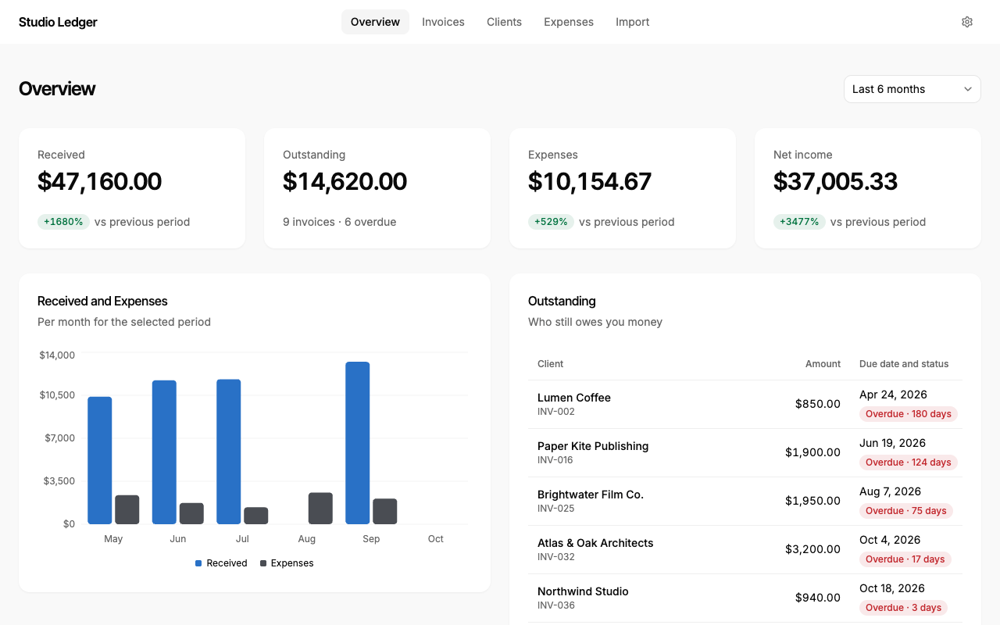

---

## 1. The problem

Freelancers spread invoices, clients, income and expenses across spreadsheets, banking apps and notes. Answering "how am I doing?" takes manual calculation, and three things go wrong:

- **Late payments go unnoticed,** so follow-ups happen late or not at all.
- **Billed work is confused with money received,** which overstates income.
- **Spending is hard to see** by month or category.

The user's goal, as written in the PRD:

> *"I want to understand how much money I've received, how much I've spent, and which clients still owe me money."*

Studio Ledger answers exactly those three questions and nothing else. It competes with the spreadsheet, not with accounting software.

## 2. The user

The primary audience is independent designers and other creative freelancers who manage several clients and track money themselves.

**Proto-persona: Maja, freelance brand designer.** This is an assumption, not research; see [What was validated, and what was assumed](#7-what-was-validated-and-what-was-assumed).

| | |
| --- | --- |
| Work | 4–8 active clients, project and retainer work |
| Volume | 5–15 invoices and 20–40 expenses a month |
| Tools today | A spreadsheet for invoices, a banking app, notes for expenses |
| Main frustration | Not knowing at a glance who has paid and who is late |
| Comfort with finance | Low to medium; avoids accounting software as too complex |

**Jobs to be done:**
1. See what I earned and spent this month.
2. Spot a late client quickly.
3. Update an invoice in seconds when I'm paid.
4. Bring in my existing records without retyping them.

## 3. Scope

### The MVP

| Area | What it does |
| --- | --- |
| Overview | Received, Outstanding, Expenses and Net income for a chosen period, each with its change against the previous period; a monthly chart; the 10 most urgent unpaid invoices |
| Invoices and clients | Add, edit and delete invoices linked to clients; filter by Paid, Pending and Overdue; search; mark paid or not paid, with a 5-second undo; a Clients page with totals per client |
| Expenses | Record, filter, edit and delete expenses in eight fixed categories |
| CSV import | Upload, match columns, preview and validate every row, then import the valid ones |
| Sample data and settings | A fictional six-month dataset that loads on a first visit; one app currency (USD, EUR or BAM); clear all data |

Three journeys define it, and each has an end-to-end test:
1. **Import records.**
2. **Understand the month.**
3. **Collect an unpaid invoice.**

### Non-goals

Studio Ledger is not accounting software. The PRD made this list binding, and every task was reviewed against it:

| Left out | Why |
| --- | --- |
| Estimated taxes | Rules vary by country; a wrong number is worse than none |
| Reminder emails, invoice PDFs | They need a backend, and they turn the product into invoicing software |
| Bank sync, Google Sheets sync | APIs, security review and consent; CSV proves the data workflow first |
| Accounts and cloud storage | Backend and authentication work; data stays in the browser |
| Mixed currencies, conversion | Exchange-rate rules |
| Export, recurring invoices, budgets, forecasts, dark mode | Not needed for the three questions |

## 4. Process

**Planned:** the PRD set out five phases in sequence, each starting only when the previous gate was met, over 8–12 weeks: foundation, rough screens, design polish, build, validation.

**What actually happened:** the work took two days, 19–20 October 2026, because an AI agent wrote the code (see [Working method](#working-method)). Only the foundation ran as a separate phase. The rough screens were working features from the start, because the agent built the logic along with the layout. Polish and build then ran side by side, with polish pull requests landing between feature pull requests. Validation hasn't happened yet.

| Stage | When | Pull requests | What happened |
| --- | --- | --- | --- |
| Foundation | 19 Oct | #18–#21 | PRD, glossary and calculation rules, data model, journeys, the fictional dataset, a GitHub issue per story. Gate: PRD approved (#21). |
| Setup and rough screens | 20 Oct, morning | #22–#31 | shadcn/ui and Vercel previews (#22), then every Must screen as a working feature on the sample data: Overview, invoices, CSV import, expenses, settings and storage. Each was reviewed on its preview. Two small design fixes (#29, #30) landed between features. |
| Release checklist | 20 Oct, early afternoon | #32, #34, #35 | The Definition of Done and the verification log (#32), and "before" screenshots of every page (#35). From here on, each pull request ticked items only with evidence. |
| Polish and build, overlapping | 20 Oct, afternoon | #33, #36–#40 | Polish: chart axis labels on one line in every currency (#33); fonts, chart colours, the phone menu and a design pass (#36); card lists on phones and pagination (#37). Build, between them: the Clients page (#39) and the 5-second undo (#40). |
| Quality and polish, overlapping | 20 Oct, evening | #42–#51 | Release scope decisions (#42); CI and Playwright (#45); keyboard and contrast, with darker tokens and stronger focus rings (#47); page identity and a clean-clone check (#48). Then more polish — shadcn's field borders and 36 px controls (#49) — followed by checking every Must criterion against a test (#50) and screen-reader fixes (#51). |
| Validation | After v1.0 | — | The usability test couldn't be run in time and moved to after the release; its plan is in [section 8](#8-usability-test-not-done-yet). The design review (UX-10) comes before the release. |

The phase gates still did their job as checkpoints: every app change was reviewed on its Vercel preview, and from #45 on, nothing merged without green CI. What the gates no longer did was hold one phase back until another finished. For example, a polish change to field borders (#49) came after the contrast work it partly undid (#47). Because both were reviewed and logged, that reversal is visible in `docs/decisions.md`, not hidden.

**Designed in code, with no Figma.** The design system is shadcn/ui's components and theme tokens, kept in one file (`src/index.css`). Every pull request got a Vercel preview, and each screen was reviewed there, in the browser, at real sizes and with real data. Where a design decision changed, it was made in the code that ships, and recorded in `docs/decisions.md`.

### Working method

The code was written with an AI coding agent (Claude Code), one user story per branch and pull request. I acted as product owner, designer and reviewer. The PRD was the single source of truth. A release checklist (`docs/definition-of-done.md`) was ticked only with evidence: a passing test, a reviewed preview, or a check in the browser. A dated verification log records what was checked and what wasn't.

**In numbers:**
- 34 merged pull requests up to this draft (#18–#53), with CI on every one from #45 on.
- 223 unit and component tests.
- 60 Playwright tests: the three core journeys, keyboard-only flows, text and non-text contrast, the screen-reader checks, and a check that the app makes no network calls.

> **✍️ To fill in: working with an AI agent.** What it was like to direct the build: where it helped, where you had to correct it, and what you'd change in how you briefed it. Examples you might use from the pull requests:
> - The stacked-PR mistake that led to the "never stack pull requests" rule.
> - Pushing to an already-merged pull request.
> - Its suggestion to reword checklist items when evidence couldn't exist (TEST-4, GIT-3).

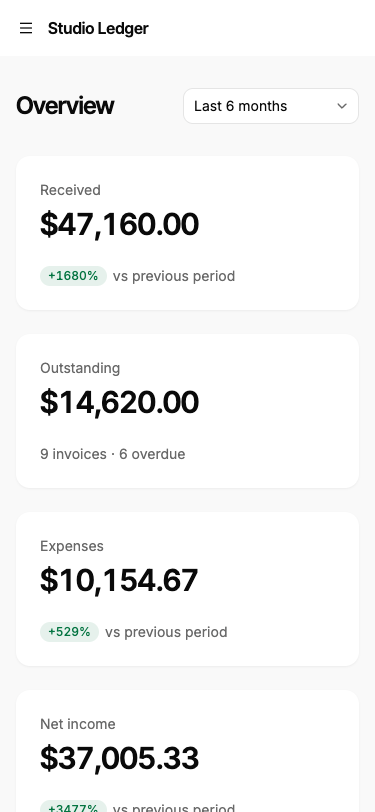

## 5. Decisions and trade-offs

The decisions that shaped the product, from `docs/decisions.md` and the pull requests:

**Income is cash received, not billed.** Received counts an invoice in the month it was *paid*, never the month it was issued. It answers "what came in?" honestly. A late payment shows up in the month the money arrived, so a month with no income (August in the sample) really shows $0.00. The UI never says "revenue", "billed" or "unpaid"; a glossary test fails the build if those words appear.

**Money is stored in integer cents.** All maths uses whole numbers, and formatting happens only for display. Calculation tests check every figure against a hand-worked dataset.

**One currency, no conversion.** USD by default, with EUR or BAM in Settings. Switching changes only how amounts look ($1,250.00, €1,250.00, 1.250,00 KM). Exchange rates would have doubled the rules for little gain.

**Paid or not paid, nothing in between.** No partial payments, which keeps status and totals simple.

**Everything stays in the browser.** No backend and no accounts. The trade-off is that clearing site data loses records. Settings says so, and export is planned for v1.1.

**A first visit opens on the sample.** The dashboard is never empty the first time. After "Clear all data", it stays empty and offers Add, Import CSV or Load sample data. An earlier banner saying "you're looking at sample data" was removed in review as noise.

**Import that avoids errors instead of reporting them.** Column matching first showed errors when two columns pointed at the same field. After several review rounds:
- Picking a field another column has **swaps** the two.
- Each column has an **Import switch**. Required fields' switches are locked on, with a tooltip saying why.
- A **reset** button returns to the automatic match.
- Ambiguous dates are suggested from the currency: MM/DD/YYYY for USD, DD/MM/YYYY for EUR and BAM.

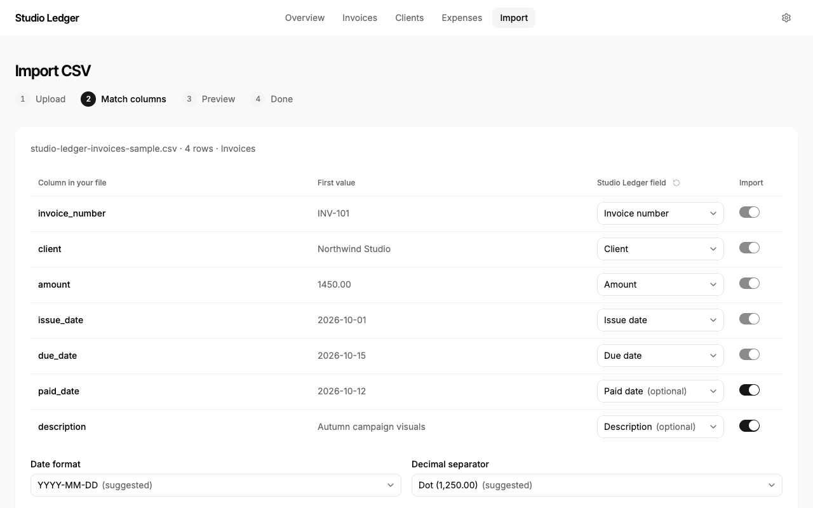

**Undo inside the panel too.** Marking paid shows a toast with Undo for 5 seconds. The invoice panel is a modal, which keeps keyboard focus inside it, so the toast's button can't be reached by Tab. The panel shows the same Undo itself, and focus goes to it.

**Invoices become cards below 1024 px.** The seven-column table didn't fit a tablet: at 768 px it was 160 px wider than its card. Other lists switch at 768 px.

**shadcn's look, with stronger focus.** For contrast, four text colours were darkened, and the focus ring is solid at 4.5:1 or more on every Tab stop. Field borders were first darkened to 3:1, then put back to shadcn's light default by choice. Fields are found by their visible labels and the focus ring. That one trade-off is written into the accessibility checklist (A11Y-3). All controls are 36 px tall, so buttons, fields and tabs line up.

**Scope cuts.** Table sorting moved to future work; filtering and search already answer "where is that invoice?". The usability test shrank from 5–8 people to 2–3, then moved to after the release, because it couldn't be run in time (see section 8).

## 6. Accessibility and quality

| Area | How it was checked |
| --- | --- |
| Keyboard | Every flow is done by keyboard alone in Playwright, with no clicks. Every Tab stop must show a focus ring of at least 3:1, and Tab must leave each page (no traps). The tests found and fixed real bugs: invoice search dropped letters typed quickly, and focus was lost after undo. |
| Contrast | axe-core's colour-contrast rule on every page, panel, error and import step, at desktop and phone width. A separate 3:1 check covers radios, switches, focus rings, chart bars and selected states. |
| Screen readers | Each page has its own title and announces itself, section titles are headings, tables are named, and errors are tied to their fields. Search results and Mark as paid are announced. A VoiceOver pass in Safari passed all 18 steps. |
| Correctness | Every Must acceptance criterion in the PRD is matched to a passing test (PB-28). |
| Privacy | A test records every request while using the app: none leave it. Fonts are bundled, and production loads only its own files. |
| Delivery | CI runs lint, the unit tests, the build and Playwright on every pull request. Each pull request gets a Vercel preview. |

## 7. What was validated, and what was assumed

**Discovery interviews were skipped** for time (decided 2026-10-19). The persona, the jobs to be done and the competitor notes are assumptions. No user has been observed using the app yet; the test planned in [section 8](#8-usability-test-not-done-yet) will be the first contact with real users.

| Claim | Status |
| --- | --- |
| Figures follow the calculation rules exactly | **Validated** by automated tests on a hand-worked dataset |
| Every flow works by keyboard and with VoiceOver | **Validated** by tests and a VoiceOver pass |
| Tracking who owes money is the most painful job | **Assumed**, not tested yet |
| Freelancers keep records they can export as CSV | **Assumed**, not tested yet |
| They'd rather import a CSV than type records | **Assumed**, not tested yet; the biggest open bet |
| Cash received is more useful than billed revenue | **Assumed**, not tested yet |
| A monthly view is the right default (the app opens on Last 6 months) | **Assumed**, not tested yet |

## 8. Usability test: not done yet

**Studio Ledger hasn't been tested with users yet.** The usability test was planned for before the release (CASE-3), but it couldn't be run in time, so it moved to after v1.0 (decided 21 October 2026). No user outside the project has been observed using it. Everything in [section 7](#7-what-was-validated-and-what-was-assumed) marked "assumed" is still a guess, including the biggest one: that freelancers would rather import a CSV than type their records. What *is* checked is that the app works as specified: its figures, its flows, and its accessibility, by automated tests and a VoiceOver pass.

### Test plan for later

| | |
| --- | --- |
| **Who** | 2–3 freelance creatives who match the persona: several clients, tracking money themselves, ideally with an invoice spreadsheet they could export. Not people who worked on the project. |
| **Setup** | 30 minutes each, remote or in person, on the live demo with the sample data, on their own laptop. Think-aloud, with screen and audio recorded with consent. The moderator doesn't help unless someone is stuck for 2 minutes. |
| **Before** | How do you track invoices and expenses today? Who owes you money right now, and how do you know? |
| **Tasks** | 1. How much have you received this month? 2. Which clients still owe you money? 3. Lumen Coffee has just paid invoice INV-002; record it. 4. Import this CSV of invoices (the sample file). 5. Add one expense by hand. |
| **After each task** | Ease rating (SEQ, 1–7). |
| **After all tasks** | Would you rather import a CSV or type your records, and why? Rank the three questions (received, spent, who owes you) by how much they matter. Does "Received" mean what you expected? Is the default period right for you? |

**Targets,** from the PRD:

| Task | Target |
| --- | --- |
| Find total received this month | ≥ 90% success, under 10 s |
| Identify which clients owe money | ≥ 90% success, under 15 s |
| Mark an invoice as paid | ≥ 90% success, under 20 s |
| Complete a CSV import with a sample file | ≥ 80% success without help |
| Ease rating (SEQ, 1–7) | Average ≥ 5.5 per task |

**Reporting:**
- Results replace this section: success, time and SEQ per task and participant, the CSV-or-typing answer, what each assumption in section 7 turned out to be, and the problems seen, ranked by severity.
- With 2–3 people, the results are directional, not statistically meaningful, and the write-up will say so.
- The fixes that follow become pull requests, like everything else.

## 9. Release screens

Real screenshots of the released app on production (October 2026), on the fictional sample.

| Desktop (1280 px) | Phone (375 px) |
| --- | --- |
|  |  |
| 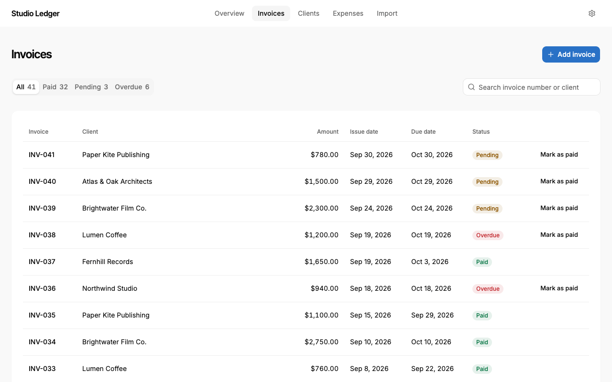 | 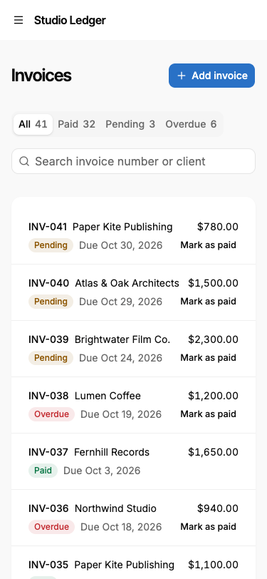 |
| 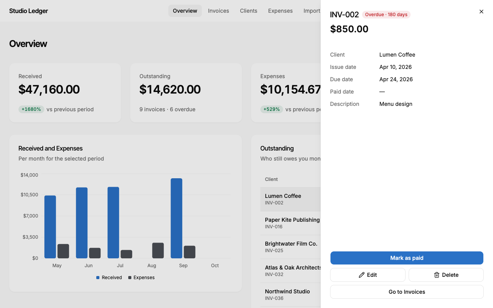 | 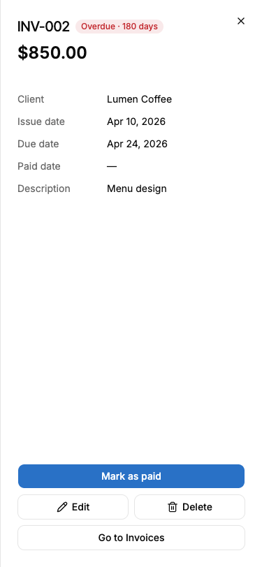 |
| 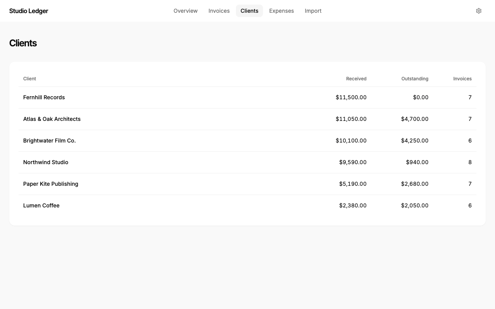 | 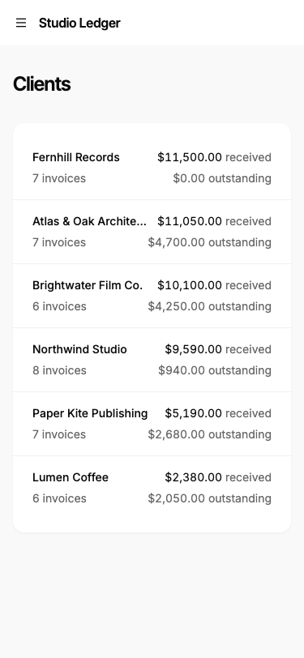 |
| 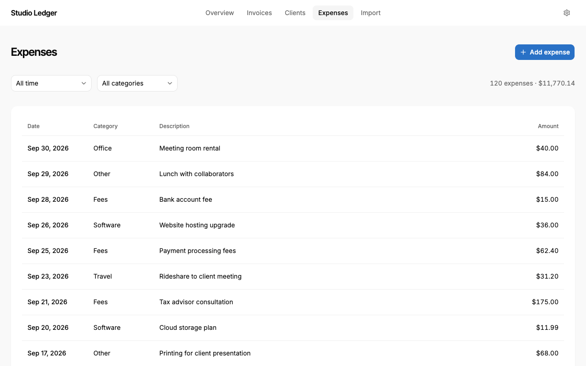 | 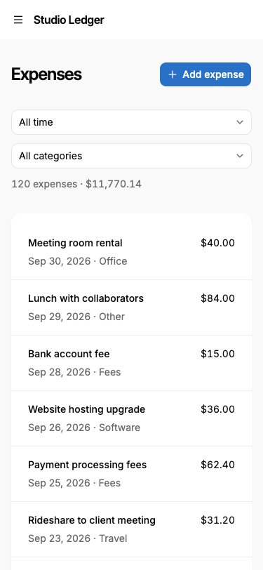 |
|  | 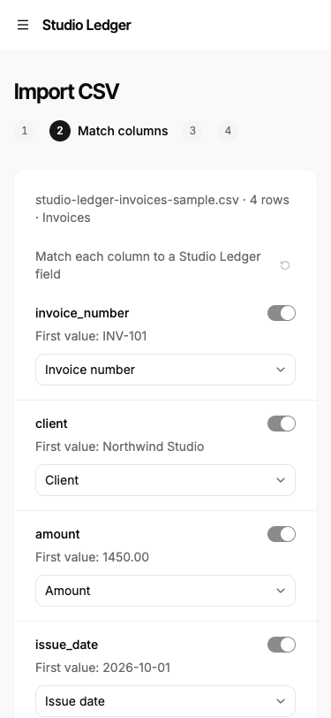 |
| 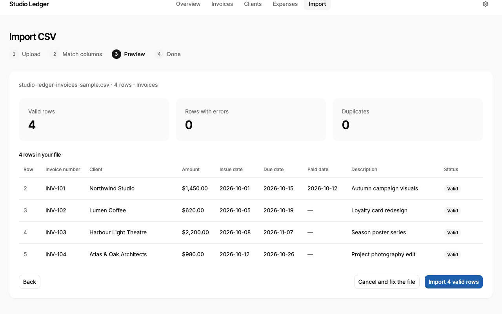 | 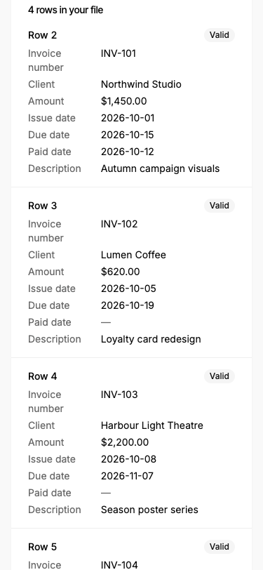 |
| 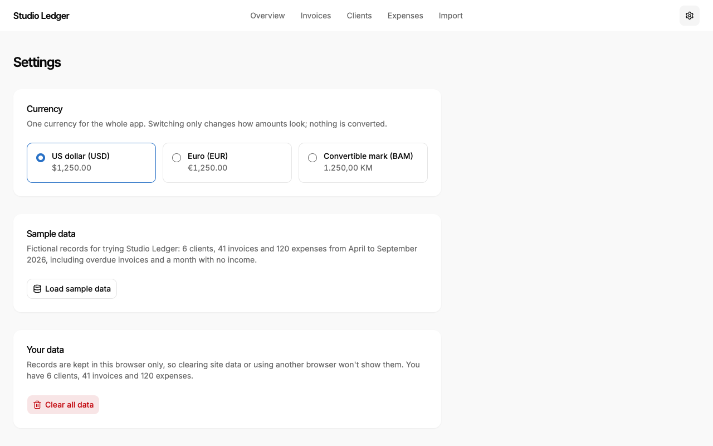 | 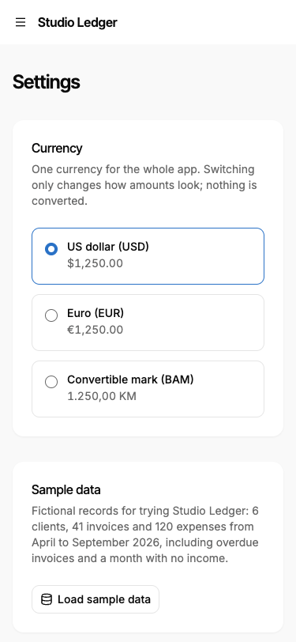 |

Full-page Overview: [desktop](screenshots/release/overview-full-desktop.png), [phone](screenshots/release/overview-full-phone.png).

## 10. What's next

Planned after v1.0, from the PRD and the future-work list:
- **First, the usability test** in [section 8](#8-usability-test-not-done-yet), and fixes for what it finds. Its results may reorder everything below.
- Export (v1.1).
- Read-only Google Sheets sync (v1.1 at the earliest).
- Reminder emails (v1.1).
- Dark mode (v1.1).
- Accounts and cloud storage (v1.2).
- Table sorting (#41).
- Recent activity on the Overview (US-1.4).
- A full screen-reader review, and axe scans on every screen.

## 11. Reflection

> **✍️ To fill in: your own reflections.** Some prompts:
> - What would you do differently: skipping discovery, releasing before a usability test, phase gates?
> - What did designing in code with no Figma give you, and what did it cost?
> - Which decision are you proudest of, and which one are you least sure about?
> - What did you learn about directing an AI coding agent with a PRD and a Definition of Done?

## Seeing the code

The code, the docs and the full history of pull requests are public on GitHub: [github.com/begovacamina-source/studio-ledger](https://github.com/begovacamina-source/studio-ledger).

Places to start in the repository:
- [`docs/PRD.md`](https://github.com/begovacamina-source/studio-ledger/blob/main/docs/PRD.md): the product definition.
- [`docs/decisions.md`](https://github.com/begovacamina-source/studio-ledger/blob/main/docs/decisions.md): why things are the way they are.
- [`docs/definition-of-done.md`](https://github.com/begovacamina-source/studio-ledger/blob/main/docs/definition-of-done.md) and [`docs/verification-log.md`](https://github.com/begovacamina-source/studio-ledger/blob/main/docs/verification-log.md): the release checklist and its evidence.
- [`src/lib/`](https://github.com/begovacamina-source/studio-ledger/tree/main/src/lib): the calculations and import logic, with their tests.
- [`e2e/`](https://github.com/begovacamina-source/studio-ledger/tree/main/e2e): the Playwright tests.
